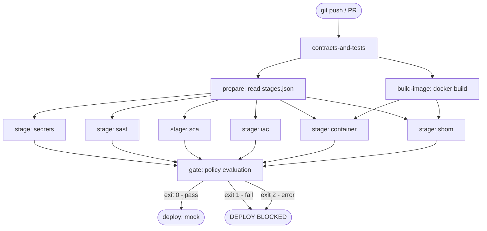

# Phase 1 Architecture

> **P1 owns this document.**

## Overview

Phase 1 delivers the foundation that P2, P3, and P4 build on without merge conflicts.
Every integration point is defined as a contract; later phases only replace stub interiors.

## Pipeline Flow



## Component Table

| Component | File(s) | Phase 1 Status | Purpose |
|-----------|---------|---------------|---------|
| Finding schema | `contracts/finding.schema.json` | Frozen | Defines normalized finding format |
| Policy schema | `contracts/policy.schema.json` | Frozen | Defines security policy format |
| SARIF profile | `contracts/sarif-profile.md` | Frozen | SARIF 2.1.0 subset all stages must emit |
| Severity map | `contracts/severity-map.md` | Frozen | Tool label → Critical/High/Medium/Low |
| Stage interface | `contracts/stage-interface.md` | Frozen | Universal stage invocation contract |
| Gate interface | `contracts/gate-interface.md` | Frozen | Gate invocation contract |
| Validator | `contracts/validate.py` | Complete | Validates SARIF and policy files |
| Stage scripts | `stages/*/run.sh` | Stub | Copy sample SARIF; replaced in Phase 2-3 |
| Stage registry | `stages/stages.json` | Complete | Drives CI matrix |
| Gate | `gate/run_gate.py` | Stub | Always passes; replaced in Phase 4 |
| Demo app | `demo-app/vulnerable/` | Complete | Intentionally flawed Flask app |
| Demo app (fixed) | `demo-app/fixed/` | Complete | Corrected version for comparison |
| CI workflow | `.github/workflows/pipeline.yml` | Complete | P1 owns forever |
| Local runner | `scripts/run-local-pipeline.sh` | Complete | Mirrors CI locally |

## Stage Interface

Every stage implements this contract (see `contracts/stage-interface.md`):

```
stages/<name>/run.sh <target_path> <output_dir>
  writes: <output_dir>/<name>.sarif   (always)
  exit 0: scan completed (regardless of findings)
  exit 1: scanner crashed/failed
  exit 2: usage error
```

## Gate Interface

The gate implements this contract (see `contracts/gate-interface.md`):

```
python gate/run_gate.py --reports <dir> --policy <file> --out <dir>
  exit 0: policy satisfied → deploy allowed
  exit 1: policy violated  → deploy BLOCKED
  exit 2: internal error   → deploy BLOCKED
  writes: <out>/gate-result.json
          <out>/findings.json
```

## Why Contracts Are Frozen

The core design principle is that **scanners report, the gate decides**.
Each stage exits 0 even when it finds vulnerabilities — it only exits non-zero if the scanner
crashes. The gate is the single point that makes the pass/fail decision.

This separation means:
- P2 can implement real Gitleaks without touching the workflow or the gate
- P3 can implement Hadolint without touching P2's stage
- P4 can implement real policy logic without touching any scanner
- Nobody ever edits `pipeline.yml` after Phase 1

The contracts are the shared language. Freezing them after everyone signs off means
"the vocabulary is fixed; fill in the implementation."

## Conflict-Free Design

Each team member owns a non-overlapping set of folders:
- P2: `stages/secrets/`, `stages/sast/`, `stages/sca/`
- P3: `stages/iac/`, `stages/container/`, `stages/sbom/`, `stages/dast/`
- P4: `gate/`, `security-policy.yaml` (from Phase 4)
- P1: everything else

A PR from P2 never touches P3's folders and vice versa, so git merge conflicts are
structurally impossible between team members' work.

