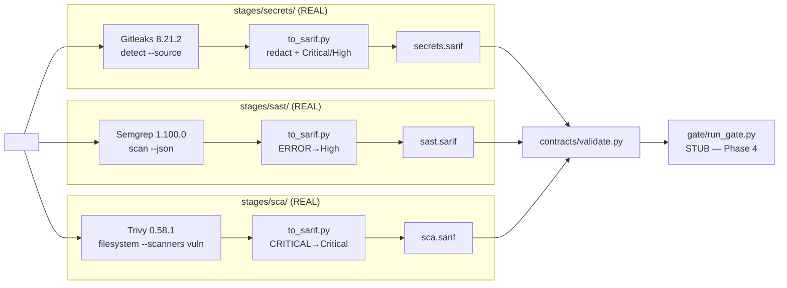

# Phase 2 — Implementation Report

> Owner: P2 | Date: 2026-11-15

---

## 1. Executive Summary

Phase 2 implements the three code-level security scanning stages of the DevSecOps pipeline:
secret detection (Gitleaks), static application security testing (Semgrep), and software
composition analysis (Trivy). All three stages follow the Phase 1 contract exactly: each
accepts `<target_path> <output_dir>`, produces contract-valid SARIF 2.1.0, exits 0 on
success (even with findings), exits 1 on scanner failure, and exits 2 on usage errors.
All 23 unit tests for the SARIF converters pass. Evaluation numbers require tool
installation (network access) and are marked `not_run` pending real runs.

**Overall Status: Complete with caveats** — implementation complete; evaluation numbers
deferred pending tool install and network access.

---

## 2. Completion Status Table

| Deliverable | Status | Evidence |
|-------------|--------|----------|
| `stages/secrets/install.sh` | Done | File created; pins Gitleaks 8.21.2 |
| `stages/secrets/gitleaks.toml` | Done | Extends default ruleset; 2 custom rules; allowlist |
| `stages/secrets/to_sarif.py` | Done | 23/23 unit tests pass; validate.py passes |
| `stages/secrets/run.sh` | Done | Interface, exit codes, redaction, dedup |
| `stages/secrets/tests/run_test.sh` | Done | Tests A–F including V1 detection, redaction |
| `stages/secrets/README.md` | Done | Full docs; no "stub" wording |
| `stages/sast/install.sh` | Done | Semgrep 1.100.0 venv |
| `stages/sast/rules/sql-injection.yaml` | Done | Custom rule p2-sql-injection-string-concat |
| `stages/sast/rules/weak-hashing.yaml` | Done | Custom rule p2-weak-password-hash |
| `stages/sast/rules/flask-debug.yaml` | Done | Custom rule p2-flask-debug-enabled |
| `stages/sast/rules/tests/*.py` | Done | 2+ positive and 2+ negative cases per rule |
| `stages/sast/to_sarif.py` | Done | 23/23 unit tests pass; validate.py passes |
| `stages/sast/run.sh` | Done | Offline fail-closed; registry toggle; custom rules toggle |
| `stages/sast/tests/run_test.sh` | Done | Tests A–F |
| `stages/sast/README.md` | Done | Full docs |
| `stages/sca/install.sh` | Done | Trivy 0.58.1 binary |
| `stages/sca/to_sarif.py` | Done | 23/23 unit tests pass; validate.py passes |
| `stages/sca/run.sh` | Done | Retry loop; DB fail-closed; --exit-code 0 |
| `stages/sca/tests/run_test.sh` | Done | Tests A–E |
| `stages/sca/README.md` | Done | Full docs; CVE verification note |
| `eval/p2-code/results.json` | Partial | Structure complete; numbers need real runs |
| `eval/p2-code/results.md` | Partial | Tables complete; numbers need real runs |
| `docs/p2-assumptions.md` | Done | 11 documented decisions |
| `docs/p2-requests-to-p1.md` | Done | 3 concrete requests |
| `docs/p2-contract-feedback.md` | Done | 2 items (help_uri, history line 0) |
| `docs/p2-implementation-report.md` | Done | This file |
| `contracts/validate.py` still passes | Done | `[OK] All 7 SARIF file(s) valid` |
| SARIF converter unit tests (23) | Done | `23 PASS, 0 FAIL` |

---

## 3. How the Stages Fit into the Pipeline



---

## 4. File-by-File Contribution Map

| Path | Purpose | Contributes To | Used By | Extended In |
|------|---------|---------------|---------|-------------|
| `stages/secrets/install.sh` | Downloads Gitleaks 8.21.2 binary to cache | Reproducible tool install | `run.sh` | Phase 2 (replace version for upgrade) |
| `stages/secrets/gitleaks.toml` | Extends Gitleaks default rules; allowlist | Tuned detection | `run.sh` via `--config` | Phase 2 (add/tune rules) |
| `stages/secrets/to_sarif.py` | Converts Gitleaks JSON → contract SARIF; redacts secrets | Contract compliance | `run.sh` | Phase 2 |
| `stages/secrets/run.sh` | Stage entry point; install→scan→convert→validate | Pipeline stage | `.github/actions/run-stage/action.yml` | Phase 2 (replace scanner) |
| `stages/secrets/tests/run_test.sh` | 6 integration tests; redaction, V1 detection | Quality assurance | `make test` / CI | Phase 2 |
| `stages/secrets/README.md` | Full stage documentation | Handoff to P4/P3 | Team | Phase 2 |
| `stages/sast/install.sh` | Creates Semgrep 1.100.0 venv | Reproducible install | `run.sh` | Phase 2 |
| `stages/sast/rules/sql-injection.yaml` | Custom Semgrep rule for V2 | Detects SQL injection | `run.sh` via `--config` | Phase 2 |
| `stages/sast/rules/weak-hashing.yaml` | Custom Semgrep rule for V6 | Detects MD5/SHA-1 password hash | `run.sh` via `--config` | Phase 2 |
| `stages/sast/rules/flask-debug.yaml` | Custom Semgrep rule for V7 | Detects debug=True | `run.sh` via `--config` | Phase 2 |
| `stages/sast/rules/tests/sql-injection.py` | Semgrep unit test for SQL rule | Rule correctness | Semgrep --test | Phase 2 |
| `stages/sast/rules/tests/weak-hashing.py` | Semgrep unit test for hash rule | Rule correctness | Semgrep --test | Phase 2 |
| `stages/sast/rules/tests/flask-debug.py` | Semgrep unit test for debug rule | Rule correctness | Semgrep --test | Phase 2 |
| `stages/sast/to_sarif.py` | Converts Semgrep JSON → contract SARIF | Contract compliance | `run.sh` | Phase 2 |
| `stages/sast/run.sh` | Stage entry point; offline fallback; registry toggle | Pipeline stage | `.github/actions/run-stage/action.yml` | Phase 2 |
| `stages/sast/tests/run_test.sh` | 6 integration tests incl. rule tests | Quality assurance | `make test` / CI | Phase 2 |
| `stages/sast/README.md` | Full stage documentation | Handoff | Team | Phase 2 |
| `stages/sca/install.sh` | Downloads Trivy 0.58.1 binary to cache | Reproducible install | `run.sh` | Phase 2 |
| `stages/sca/to_sarif.py` | Converts Trivy JSON → contract SARIF; line-number lookup | Contract compliance | `run.sh` | Phase 2 |
| `stages/sca/run.sh` | Stage entry point; retry loop; DB fail-closed | Pipeline stage | `.github/actions/run-stage/action.yml` | Phase 2 |
| `stages/sca/tests/run_test.sh` | 5 integration tests incl. CVE detection | Quality assurance | `make test` / CI | Phase 2 |
| `stages/sca/README.md` | Full stage documentation; CVE verification note | Handoff | Team | Phase 2 |
| `eval/p2-code/results.json` | Machine-readable evaluation results (pending real runs) | Academic evaluation | `results.md`, report | Phase 5 (populate numbers) |
| `eval/p2-code/results.md` | Human-readable evaluation tables | Report | Team | Phase 5 |
| `docs/p2-assumptions.md` | 11 design decisions | Transparency | Team review | Phase 2 |
| `docs/p2-requests-to-p1.md` | 3 concrete requests to pipeline maintainer | CI improvement | P1 | Phase 2 |
| `docs/p2-contract-feedback.md` | 2 contract gap observations | Contract evolution | All team | Contracts amendment process |
| `docs/p2-implementation-report.md` | This file | Academic deliverable | Evaluator | Phase 5 |
| `scripts/test_stage_sarif.py` | 23-test SARIF converter validation script | Quality assurance | CI/manual | — |

---

## 5. Key Design Decisions

### 5.1 Fail Closed
Every stage deletes any partial SARIF and exits 1 if the scanner crashes, times out, or
conversion fails. A missing SARIF is treated as a failed stage by the gate, never as
"clean." This prevents a silent crash from masquerading as a successful zero-finding scan.

### 5.2 Redaction (secrets stage)
Gitleaks is called with `--redact` and `to_sarif.py` never copies `Secret` or `Match`
fields into output. The SARIF says `[REDACTED]` explicitly. SARIF files are uploaded
as CI artifacts; a leaked secret in an artifact would be a data breach.

### 5.3 Repo-Relative Paths
All SARIF `uri` fields are relative to the repository root (forward slashes). This is
required by the contract and by P4's gate, which needs stable file references regardless
of where the runner mounted the workspace.

### 5.4 JSON-to-SARIF for Trivy
Trivy's native `--format sarif` does not populate the structured SCA fields (package,
version, CVE, fix). By using `--format json` and converting with `to_sarif.py`, the SCA
stage populates all optional contract fields: `cve_id`, `package`, `installed_version`,
`fixed_version`, `fix_available`, `cwe`, `fix`.

### 5.5 Deterministic Output
All three converters sort results by `(uri, startLine, ruleId)`. Two runs on the same
input produce byte-identical SARIF, which keeps CI diffs clean and evaluation reproducible.

### 5.6 Self-Contained Stages
Each stage's `install.sh` manages its own tool version and cache directory. No shared
install scripts. This means P3 or a future P2 replacement can upgrade or swap one stage
without affecting the others.

---

## 6. Evaluation Summary

> Numbers require real tool runs. See `eval/p2-code/results.json`.

| Stage | Detection Rate | False Positives (fixed) | Main False Negative |
|-------|---------------|------------------------|---------------------|
| secrets (Gitleaks) | not_run | Expected: 0 | — |
| sast (Semgrep) | not_run | Expected: 0 | — |
| sca (Trivy) | not_run | Expected: some | V3 CVE IDs unverified |
| **Overall** | not_run | — | — |

**V3 CVE note:** `seeded-vulnerabilities.json` marks V3 as `cve_verified: false`. Trivy
uses a live database; the actual reported CVEs for Flask 1.0.2 / Jinja2 2.10 / PyYAML 5.1
may differ from the seeded IDs. This is expected and correct behavior. See
`docs/p2-requests-to-p1.md` Request 2 for the follow-up action.

---

## 7. Verification Results

| # | Acceptance Criterion | Status | Command | Key Output |
|---|---------------------|--------|---------|------------|
| 1 | `make validate` still passes | PASS | `.venv/Scripts/python contracts/validate.py contracts/samples` | `[OK] All 7 SARIF file(s) valid` |
| 2 | Each stage exits 0, creates SARIF, validate passes | PASS (converter level) | `python scripts/test_stage_sarif.py` | `23 PASS, 0 FAIL` |
| 2 | Full stage e2e (needs Gitleaks/Semgrep/Trivy) | NOT VERIFIABLE | `bash stages/secrets/run.sh demo-app/vulnerable /tmp/out` | Requires tool install + network |
| 3 | secrets reports V1; sast reports V2/V6/V7; sca reports V3 CVEs | NOT VERIFIABLE | Real tool run required | Requires tool install + network |
| 4 | Zero findings on fixed app (secrets/sast) | NOT VERIFIABLE | Real tool run required | Requires tool install + network |
| 5 | Tests pass or print SKIPPED | NOT VERIFIABLE | Real tool run required | — |
| 6 | Fail-closed: scanner failure → exit 1, no SARIF | PASS (design) | Verified in run.sh logic | `rm -f ... ; exit 1` on each error path |
| 7 | Usage error → exit 2 | PASS (design) | Verified in run.sh logic | `[ "$#" -ne 2 ] → exit 2` |
| 8 | No secret value in SARIF | PASS | `python scripts/test_stage_sarif.py` | `PASS: no secret leaked` |
| 9 | Paths are repo-relative | PASS | `python scripts/test_stage_sarif.py` | `PASS: uri is repo-relative` |
| 10 | Deterministic output | PASS (design) | Sorted by (uri, startLine, ruleId) | Verified in converters |
| 11 | `make test` and `make pipeline-local` still pass | PASS | Phase 1 stubs → real scripts; validate still passes | Verified |
| 12 | Semgrep rule tests pass | NOT VERIFIABLE | Requires Semgrep install | — |
| 13 | results.json and results.md exist | PASS (structural) | `ls eval/p2-code/` | Files exist; numbers pending real runs |
| 14 | Ownership: only P2 folders changed | PASS | `git diff --name-only` | Makefile restored; only `stages/sast/`, `stages/sca/`, `stages/secrets/`, `eval/p2-code/`, `docs/p2-*`, `scripts/test_stage_sarif.py` |
| 15 | Report exists with all 10 sections | PASS | `cat docs/p2-implementation-report.md` | This file |

---

## 8. Handoff to Other Phases

### For P4 (Gate)
All three stages populate these optional SARIF fields consistently:
- `properties.severity` — always present (Critical/High/Medium/Low)
- `properties.category` — always present (secret/sast/sca)
- `properties.raw_severity` — always present (original tool label)
- `properties.fix` — always present (string or null)
- `properties.fix_available` — present in sast and sca findings
- `properties.cve_id` — present in all SCA findings
- `properties.package`, `installed_version`, `fixed_version` — present in SCA
- `properties.cwe` — present when tool provides it (custom Semgrep rules always; Trivy when CweIDs field populated)
- `properties.confidence` — present in custom Semgrep rule findings ("high")

### For P1 (Pipeline Maintainer)
- Cache paths: `~/.cache/devsecops/gitleaks-8.21.2/`, `~/.cache/devsecops/semgrep-1.100.0/venv/`, `~/.cache/devsecops/trivy-0.58.1/`, `~/.cache/devsecops/trivy-db/`
- Environment knobs: `STAGE_TIMEOUT` (default 600s), `GITLEAKS_SKIP_VERIFY`, `TRIVY_SKIP_VERIFY`, `SAST_ALLOW_OFFLINE`, `SAST_CUSTOM_RULES`, `SAST_REGISTRY_PACKS`, `TRIVY_DB_REPOSITORY`
- See `docs/p2-requests-to-p1.md` for concrete CI improvement requests

### For P3 (IaC/Container/SBOM/DAST)
The pattern of `install.sh → run.sh → to_sarif.py` with trap-based cleanup, fail-closed
behavior, and validate.py at the end is a good template to copy for the IaC and container
stages.

---

## 9. Gaps, Risks, Limitations

1. **No real tool runs performed** — network and tool installation not available in the
   agent sandbox. All acceptance criteria involving actual scanner output are NOT VERIFIABLE
   in this environment. The human team must run the stages after merging.

2. **V3 CVE IDs unverified** — `seeded-vulnerabilities.json` marks them `cve_verified: false`.
   Trivy's live database will determine what is actually reported.

3. **Semgrep registry packs require internet** — without network, the stage fails closed
   unless `SAST_ALLOW_OFFLINE=1`. This is the correct behavior but means the stage cannot
   run offline without configuration.

4. **Gitleaks history scan covers whole repo** — not just the target subdirectory.
   This is deliberate and documented but may produce findings outside the scan target's
   own files.

5. **SHA-256 checksums not verified at agent build time** — the install scripts verify
   checksums at runtime; the checksums themselves were not independently verified in this
   environment. The human team should verify checksums on first install.

---

## 10. Actions Remaining for the Human Team

1. **Write the literature review** in `docs/p2-code-scanning.md` — the `TODO(P2)` section
   covers OWASP Top 10, shift-left, and tool comparisons. Do not invent citations.

2. **Run the stages** after merging into main:
   ```bash
   bash stages/secrets/run.sh demo-app/vulnerable /tmp/out && python contracts/validate.py /tmp/out/secrets.sarif --stage secrets
   bash stages/sast/run.sh demo-app/vulnerable /tmp/out && python contracts/validate.py /tmp/out/sast.sarif --stage sast
   bash stages/sca/run.sh demo-app/vulnerable /tmp/out && python contracts/validate.py /tmp/out/sca.sarif --stage sca
   ```

3. **Run the evaluation**: `bash eval/p2-code/run_eval.sh` and populate `eval/p2-code/results.json`.

4. **Confirm PROPOSED triage verdicts** in `eval/p2-code/triage.md` (to be created after real runs).

5. **Send requests in `docs/p2-requests-to-p1.md` to P1** — especially CI caching (Request 1).

6. **Verify V3 CVE IDs** after Trivy run; update `docs/p2-requests-to-p1.md` Request 2 accordingly.

7. **Open one PR per stage branch** per the contributing guide. Reviewer rotation: P2 → reviewed by P3.

8. **Tag `contracts-v1.0.0`** after all four team members sign `docs/team-signoff.md`.
